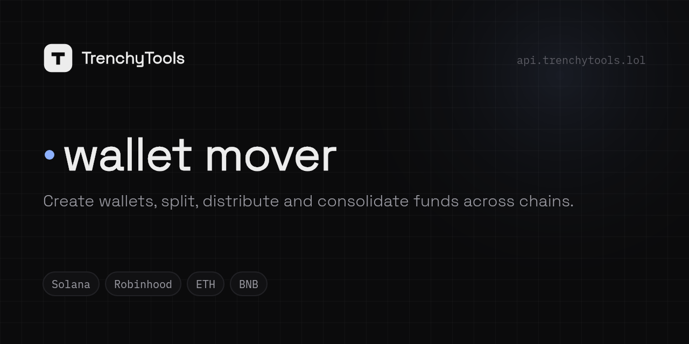

**Start here → [trenchy.tools](https://trenchy.tools)** · part of [TrenchyTools](https://github.com/Trenchy-Tools) — one API key to launch and trade on pump.fun and pons.

<!-- trenchytools:header -->
<p align="center"></p>

<p align="center"><a href="https://mover.trenchy.tools"><b>Live demo</b></a> · <a href="https://trenchy.tools/docs">Docs</a> · <a href="https://api.trenchy.tools/api/create-api-key">Get an API key</a> · <a href="https://api.trenchy.tools/AGENTS.md">AGENTS.md</a> · <a href="https://api.trenchy.tools/openapi.json">OpenAPI</a> · <a href="https://trenchy.tools/status">Status</a> · <a href="https://t.me/trenchytools">Telegram</a> · <a href="https://x.com/trenchytoolz">X</a></p>

# wallet mover

Move money between many wallets and chains on the [TrenchyTools API](https://api.trenchy.tools): create wallets on
Solana and Robinhood chain, fund them, split, distribute, consolidate, hop through an exchange (same chain or
cross-chain, optionally through a named venue to break a wallet cluster, or through a privacy-coin leg). One Next.js
app, one process, keys as files on your Desktop.

A sibling of `pumpfun-starter` and `pons-starter`: same theme, same scaffold, **same wallet folder**. A wallet made
here is usable there at once.

## 5-minute start

```bash
cd demos/wallet-mover
npm install
cp .env.example .env
curl "https://api.trenchy.tools/api/create-api-key?label=wallet-mover"   # → { "apiKey": "…" }; paste it into .env as TRENCHY_API_KEY
npm run dev                                                                  # http://localhost:3000
```

Open **Wallets**, press **+ New wallet** twice (Solana), fund the starred one (★) from your own wallet (copy its address
from the row), open **Move**, press **From** on ★ and **To** on the other, type an amount (or **Max**), press **Send**.
Start with tiny sizes.

The key can also be pasted in **Settings** (top right); it is then saved to `_app/wallet-mover/settings.json` in the
wallet folder, never in the repo.

## Where your keys are

```
WALLET_BACKUP_DIR                  when set
~/Desktop/trenchytools-wallets     when a Desktop folder exists
~/trenchytools-wallets             otherwise
```

That folder **is** the wallet store. One JSON per wallet, created before the response that announces it returns:

```
<date>-<chain>-<role>-<address>.json
{ "publicKey", "privateKey", "chain": "sol" | "rh" | "eth" | "bnb", "role", "label", "createdAt", "app": "trenchytools-wallet-mover", "note" }
wallets.csv                        createdAt,chain,role,label,publicKey,privateKey   (one line per wallet)
_app/wallet-mover/                 settings.json, transfers.json (this app's state)
```

Solana files hold a base58 64-byte secret, EVM files a `0x` key. An EVM key owns the same address on every EVM
chain; a file still carries the one chain it was made for, so the same `0x` address may appear once per chain.

**The rule:** no leg ever pays a wallet of yours unless its file exists. Delete a file and the next Run to that wallet
is refused with `409 not_backed_up`; **Rewrite backups** (Wallets page) restores it from its `wallets.csv` line.
**Export selected as CSV** writes a copy of the chosen rows, keys included, after a confirm. The folder path is in the
strip under the top bar at all times.

Treat the folder like a seed phrase: back it up, never paste it into a chat, never commit it.

## How a move works

Everything goes through the API; this app signs locally with keys read from the folder and never talks to an RPC
node. Every method in `lib/trenchy.ts` names the endpoint it calls.

**Preflight (before anything is created).** `GET /api/sol/balances?wallets=…` / `GET /api/rh/balances?wallets=…` for
every source. A source must hold its legs plus the gas reserve (0.001 SOL / 0.00005 ETH, Settings). Otherwise the
Run stops with a plain message and nothing has been created, signed or sent.

**A direct leg** (same chain; the two wallets are linked on chain):

1. `POST /api/transfer` with `route: "direct"` (or one `POST /api/transfer/batch` for a fan-out / consolidate) — a record with a `transferId`
2. Solana: `GET /api/sol/blockhash` → build one `SystemProgram.transfer` → sign (`lib/core/sol.ts`) → `POST /api/sol/send` (simulated first)
   Robinhood: `GET /api/rh/account?wallet=…` (chain id, pending nonce, fee values) → sign `{to, value, gas: 21000}` with viem (`lib/core/evm.ts`) → `POST /api/rh/send`
3. `POST /api/transfer/:id/sent { hash }` — the record is complete
4. `GET /api/sol/tx/:signature` / `GET /api/rh/tx/:hash` until confirmed

**An exchange leg** (same chain or cross-chain; the exchange pays the destination):

1. `POST /api/transfer` (or `/batch`) with `route: "exchange"`, `mode`, `venue` → a one-time deposit address and an **unsigned deposit transaction** from your wallet
2. Verify it before signing: paid by our wallet, to this leg's deposit address, exactly the deposit amount, one plain transfer (`verifySolDeposit` / `verifyEvmDeposit`)
3. Sign → `POST /api/sol/send` / `POST /api/rh/send`
4. `POST /api/transfer/:id/sent { hash }`
5. `GET /api/transfer/:id` every 10 s until `completed` (payoutHash) or `failed | expired | refunded | cancelled`. The answer's `receipt` link and, when the API attaches it, the `help` block (why, what to do, support contacts) are shown as they came.

Destination balances are polled every 5 s while legs are in flight. Every leg is written to
`_app/wallet-mover/transfers.json`; the **Activity** page merges that with `GET /api/transfer`.

## Wallets

One list. **+ New wallet** asks the chain (Solana / EVM) and creates one wallet, labelled "Wallet N"; the **× N** stepper
creates several. **Import ▾** takes a base58 or 0x key. The **★** row is the main wallet of its chain: it pays every
**Fund** and receives every **Gather** (the first wallet created on a chain is starred; click ☆ on any row to move it).
Click a label to rename it (an optional tag like `bundle` or `dev` is what the launchers pick wallets up by). **Fund**
on a row is an amount + *Send from ★*; **Key** shows the private key. Select rows for the bar: *Amount each* + **Fund
from ★**, **Fund via exchange ▾** (mode + venue inline), **Gather to ★** (Max all into ★), **Export keys**, **Archive**
(hides the row; the key file stays). ★ and archived flags live in `_app/wallet-mover/settings.json`.

## Move — the desk

Wallets on the left, **From** and **To** baskets on the right, one **Run** button. Press **From** / **To** on a wallet
to put it in a basket (or paste any address into To). The side with more wallets carries the amounts:

| From | To | Shape | Where the amounts are |
|---|---|---|---|
| 1 | 1 | send | the From row: an amount, or **Max** (balance − gas reserve) |
| 1 | many | distribute | the To rows: type each, **Split evenly** / **Split unevenly** *of* a total (prefilled with the source's max), or **Set every amount to** 0.01 · 0.05 · 0.1 · 0.5 · 1 |
| many | 1 | consolidate | the From rows: an amount per source, **Max** per row, **Max all** |
| many | many | pair up | row *i* of From pays row *i* of To (equal counts) |
| many | many + **Scatter amounts** | pool & redistribute | From rows pay a fresh **relay wallet** (created and backed up when the move starts); once the pool has landed the relay pays the destinations unrelated cuts. **Re-roll** draws another split; the run reproduces the draw you saw |

Under the baskets: the **route** (Direct, or Exchange with venue and mode inline; different chains force Exchange;
closed venues stay listed, disabled, with their reason; venue health under *venues ▾*), then the **plan line**:
`distribute · Wallet 1 → 3 wallets · 1.2 SOL in 3 transfers` or the sentence that explains what is missing. The plan
line *is* the preview (`POST /api/move/plan`, nothing quoted or created). **Run** asks one confirm, then signs and
sends; the legs appear underneath with live status, hashes and receipt links until every leg is terminal.

Splits live on a 0.001 grid and always sum exactly to the total. *Uneven* draws random cuts with the largest ≈ 3× the
smallest and none under 40 % of the even share. `lib/core/moves.ts` holds the arithmetic; `lib/core/plan-body.ts` turns the
desk's request into a plan ("max" rows read fresh balances); `lib/core/runner.ts` executes it.

## Routes, venues and breaking a wallet cluster

| Route | What happens |
|---|---|
| **direct** | one signed transfer per leg; same chain only; the two wallets are linked on chain |
| **exchange · auto** | the exchange pays the destination from its own hot wallet at the best execution: no on-chain path from your wallet to the destination. **Reduces on-chain linkability**; it is not anonymity, and the exchange route applies its own policies |
| **exchange · random** | an open venue rolled per leg: a fan-out whose destinations do not all arrive from one place |
| **exchange · \<venue\>** | pays the destination from the exchange you name (bybit, kucoin, htx, mexc, bitget, gate, binance): on chain, the new wallet's funder is a different exchange from the one that funded your other wallets. That is the **break the wallet cluster** option; ~1 % more than the default route. `GET /api/transfer/venues` says which are open; closed venues are disabled in the selector with their reason, and the answer's `venueHonoured` is shown when false |
| mode **float / fixed / private** | market rate (fastest) · locked output (0.8 %, deposit within ~15 min) · a privacy-coin leg (1 %, 5+ minutes) |

Cross-chain legs (SOL → ETH on Robinhood chain, SOL → BNB, …) always take the exchange route. `POST /api/move/preview`
(same body as the desk) quotes every leg with `GET /api/transfer/routes` (fee, estimated receive, minimum, ETA) and
flags legs under the minimum; the desk itself goes plan → Run, and the API refuses a leg under its minimum at creation.

## Connect it to the launchers

The pump.fun starter and the pons starter read the same folder. Create wallets here with the role the launcher picks
up (`bundle`, `sniper`, `holder`, `funding`, `dev`), fund them with a move, open the launcher: they are there. Sweep
them back with a consolidate when the launch is over. Nothing to configure: the folder is the integration.

## The one file to copy

`lib/trenchy.ts` is the whole API client: `sol.*`, `rh.*`, `transfer.*`, one documented method per endpoint, every
error as `ApiError { status, code, hint, docs }`. It depends on nothing but `fetch`. Copy it into your own project
along with `lib/core/sol.ts` (Solana signer + deposit check) and `lib/core/evm.ts` (viem signer + deposit check).

## Build it with AI

Paste this into your coding agent together with https://api.trenchy.tools/AGENTS.md:

> Build a wallet mover on the TrenchyTools API like `demos/wallet-mover`: wallets are JSON files in
> `~/Desktop/trenchytools-wallets` written before use, never pay a wallet without its file (409 `not_backed_up`),
> preflight balances with `GET /api/sol/balances` / `GET /api/rh/balances`, create legs with `POST /api/transfer` or
> `/batch`, verify the unsigned deposit (payer, destination, exact amount) before signing, send with
> `POST /api/sol/send` / `POST /api/rh/send`, record with `POST /api/transfer/:id/sent`, poll `GET /api/transfer/:id`
> and show `receipt` and `help` verbatim. Quote with `GET /api/transfer/routes`, respect `min`, check
> `GET /api/transfer/venues` before naming a venue. Describe exchange routing as "reduces on-chain linkability".

## Host it

```bash
docker build -t wallet-mover .
docker run -p 3000:3000 -v wallet-mover-data:/data -e TRENCHY_API_KEY=… wallet-mover
```

The wallet files are written to `/data/wallets` (the `/data` volume is the only state). A hosted copy is a single-user
tool with no auth layer: put it behind your own access control, and back the volume up like a seed phrase.

## Hosted demo mode

The public demo (`mover.trenchy.tools`) is this same app built in **demo mode**, so strangers can use it without anyone
holding their keys:

```bash
NEXT_PUBLIC_DEMO=1 npm run build              # build-time flag: the pages talk to the in-browser engine
DEMO_MODE=1 node .next/standalone/server.js   # runtime flag: every /api/* route answers 404 { code: "demo_mode" }
```

What differs from local mode (which is unchanged without the flags):

- **Keys live in the visitor's browser**: one `localStorage` store for every chain (Solana, Robinhood, Ethereum, BNB), one
  entry per wallet in the wallet-file shape, `chain` on each (the same 0x address may exist once per chain, like the files).
  Signing happens in the tab: web3.js for Solana (`GET /api/sol/blockhash`, the deposit check before an exchange deposit),
  viem for EVM (`GET /api/rh/account` for chain id, nonce and fees). The server keeps no state and serves no wallet route
  ([`proxy.ts`](proxy.ts) → `demoGuard` in `lib/http.ts`).
- **Backup first:** a new wallet is *not backed up*: no move pays it or signs with it (`409 not_backed_up`) until **Download
  backup** (status strip or Wallets page) has saved its key. One file per click: a JSON with every key and a CSV copy inside.
  **Export all keys** downloads everything any time. A pool move's relay wallet gets its own backup download before it is
  paid. Clearing the site's data deletes the keys.
- **Each visitor gets their own API key**, created in the browser on the first visit (`GET /api/create-api-key?label=demo-mover`)
  and kept in `localStorage`. Settings shows it, takes a pasted key, and shows the API's refusal verbatim when creation is
  rate-limited. Every API call goes straight from the browser to `https://api.trenchy.tools`.
- **A move runs in the tab**: keep it open. Jobs and the Activity ledger (`transfers.json` in local mode) live in
  `localStorage`; a move whose tab was closed is marked interrupted on the next visit.
- A strict Content-Security-Policy is sent (`next.config.ts`): scripts from this origin only, network to this origin and the API only.

How it is built: the pages call their routes through `appFetch` ([`lib/browser/demo.ts`](lib/browser/demo.ts)). In demo
mode those are answered by [`lib/browser/engine.ts`](lib/browser/engine.ts), which has the same routes and shapes and runs
the same code as the server ([`lib/core/*`](lib/core): desk body → plan, splits, the runner, the activity merge, the
signers) on the browser key store ([`lib/browser/keystore.ts`](lib/browser/keystore.ts)).

## Files

```
app/        layout.tsx  page.tsx(→wallets)  wallets/  move/  activity/
            api/wallets/{route,import,balances,export,rewrite-backups,rename,key,main,archive}  api/move/{plan,preview,run}
            api/{settings,transfer/routes,transfer/venues,activity}
components/ top-bar logo status-strip settings-sheet demo-banner api-error transfer-bits route-picker legs theme-toggle providers
            ui/{button,input,card,table,sheet}
lib/        chains.ts  trenchy.ts (API client)  wallets.ts (folder store + backup rule)  runner.ts (jobs in server memory)
            transfers.ts (transfers.json)  settings.ts (+ ★ per chain, archived)  env.ts  paths.ts  http.ts  client.ts  utils.ts
lib/core/   shared by both modes, no node imports: sol.ts  evm.ts (signers + deposit checks)  moves.ts (shapes, splits, legs)
            plan-body.ts (desk body → plan, preview)  runner.ts (preflight → create → verify → sign → send → sent → poll)
            transfers.ts (ledger + activity merge)  wallet-record.ts  errors.ts  env.ts
lib/browser/ demo mode only: demo.ts (flag + appFetch)  engine.ts (the /api routes in the tab)  keystore.ts  signer.ts  api-key.ts
proxy.ts    demo mode: every /api route → 404 demo_mode
```

MIT. Support: https://t.me/trenchytools · X @trenchytoolz.
